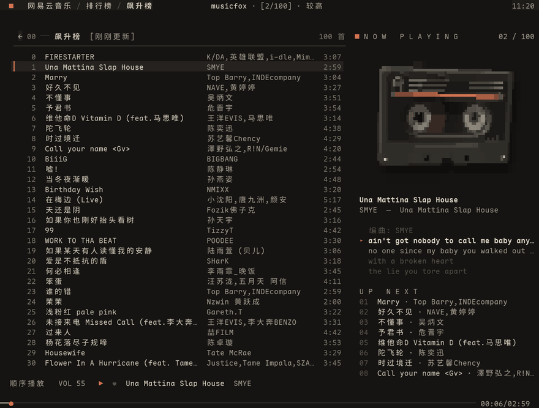
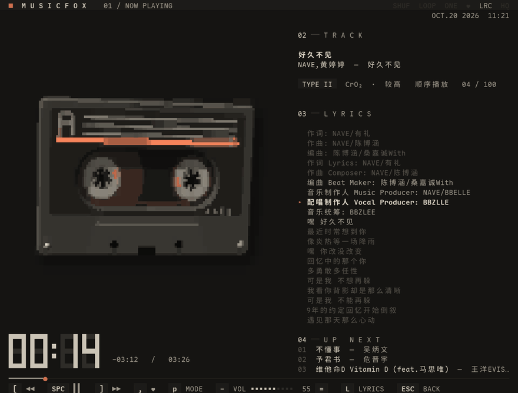
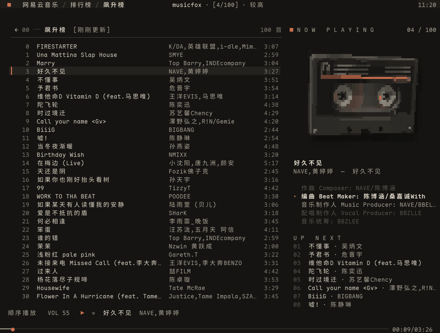
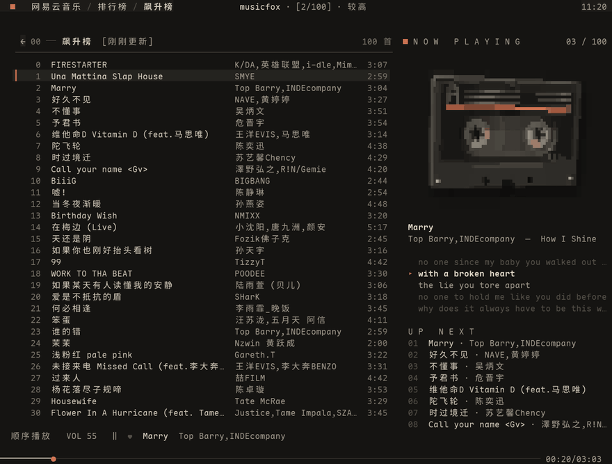
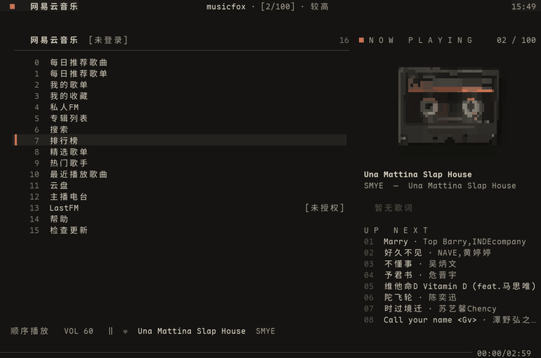
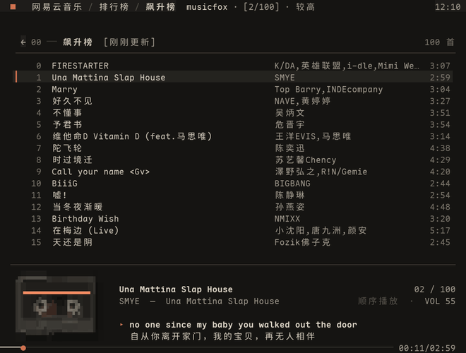

<h1 align="center">tapefox</h1>

<p align="center">
  <a href="https://github.com/Egdon/tapefox/releases"></a>
  
  
  
  
  <a href="https://github.com/go-musicfox/go-musicfox"></a>
</p>

<p align="center">磁带卡座风格的命令行网易云音乐客户端：实时渲染的 3D 磁带位于界面中心，页面切换、菜单与弹窗均配有过渡动效。</p>

<p align="center">
  <a href="https://github.com/Egdon/tapefox/releases/latest"><strong>下载最新版本</strong></a>
  ·
  <a href="./CHANGELOG.md">更新日志</a>
  ·
  <a href="https://github.com/Egdon/tapefox/issues">问题反馈</a>
  ·
  <a href="./README.en.md">English</a>
</p>

## 界面预览

### 主界面：曲目表与 3D 磁带面板



### 播放页：漂浮的磁带与逐字歌词



<table>
  <tr>
    <td width="50%" align="center"><strong>进入播放页：磁带放大至舞台</strong></td>
    <td width="50%" align="center"><strong>切歌：磁带翻面</strong></td>
  </tr>
  <tr>
    <td></td>
    <td></td>
  </tr>
  <tr>
    <td width="50%" align="center"><strong>启动：磁带从景深处转入</strong></td>
    <td width="50%" align="center"><strong>菜单进出：逐行滑入</strong></td>
  </tr>
  <tr>
    <td></td>
    <td></td>
  </tr>
  <tr>
    <td colspan="2" align="center"><strong>窄窗口：底部播放条与海报布局</strong></td>
  </tr>
  <tr>
    <td colspan="2" align="center"></td>
  </tr>
</table>

以上画面录制自程序的实际运行，磁带使用八分块字符绘制，对应 Ghostty、kitty 等终端中的效果；其他终端会自动改用较粗的字符，参见[终端与显示效果](#终端与显示效果)。

## 项目说明

tapefox 基于 [go-musicfox](https://github.com/go-musicfox/go-musicfox) v5.1.0 二次开发，重做了主界面、播放页与动效：新增 3D 磁带渲染器、曲目表与磁带面板、舞台式播放页、全局过渡动效与 Warm Night 主题，并提供 macOS、Windows 与 Linux 的预编译安装包。其余功能沿用 go-musicfox，配置与数据目录与之共用。

本仓库不是 go-musicfox 官方仓库，也不代表原作者对本项目提供支持或背书。完整变更见[更新日志](./CHANGELOG.md)。

## 下载与平台

| 平台 | 安装方式 | 架构 |
| --- | --- | --- |
| macOS 12 及以上 | Homebrew：`brew install egdon/tap/tapefox` | Apple 芯片、Intel |
| Windows 10 / 11 | Scoop：`scoop bucket add egdon https://github.com/Egdon/scoop-bucket` 后执行 `scoop install tapefox` | x64、ARM64 |
| Debian / Ubuntu | 下载 `.deb`，执行 `sudo apt install ./tapefox_*_amd64.deb` | x86_64、ARM64 |
| Fedora / openSUSE | 下载 `.rpm`，执行 `sudo dnf install ./tapefox-*.x86_64.rpm` | x86_64、ARM64 |
| Arch Linux | 下载 `.pkg.tar.zst`，执行 `sudo pacman -U tapefox-*-x86_64.pkg.tar.zst` | x86_64、ARM64 |
| 其他 Linux 发行版 | 下载 `linux_amd64.tar.gz`，将其中的 `tapefox` 放入 `PATH` | x86_64、ARM64 |

所有安装包与压缩包均发布在 [GitHub Releases](https://github.com/Egdon/tapefox/releases/latest)，并附 `SHA256SUMS` 校验文件。文件名中的 `amd64` 与 `x86_64` 指 x86_64 架构，`arm64` 与 `aarch64` 指 ARM64 架构。安装后在终端中运行 `tapefox` 启动。

### macOS

推荐使用 Homebrew 安装：

```sh
brew install egdon/tap/tapefox
```

手动安装时，下载 `darwin_arm64.tar.gz`（Apple 芯片）或 `darwin_amd64.tar.gz`（Intel）。程序未经 Apple 公证，经浏览器下载的文件在首次运行前需移除隔离属性，或在「系统设置 → 隐私与安全性」中允许运行：

```sh
xattr -d com.apple.quarantine ./tapefox
```

Homebrew 安装的程序不带隔离属性，无需此步骤。`darwin_*_macapp.zip` 为 .app 版本，系统通知中显示应用图标。

### Windows

推荐使用 Scoop 安装，之后可通过 `scoop update tapefox` 升级：

```powershell
scoop bucket add egdon https://github.com/Egdon/scoop-bucket
scoop install tapefox
```

手动安装时，下载 `windows_amd64.zip`（x64）或 `windows_arm64.zip`（ARM64），解压后在 [Windows Terminal](https://aka.ms/terminal) 中运行 `tapefox.exe`，也可将其所在目录加入 `PATH`。

程序未签名：从资源管理器启动时可能出现 SmartScreen 提示，可选择「更多信息」→「仍要运行」；开启 Windows 11 的「智能应用控制」时，未签名的程序无法运行。如安全软件报告异常，可使用 Releases 中的 `SHA256SUMS` 校验文件。

### Linux

安装包与压缩包中的程序相同，运行时依赖：

- glibc 2.34 及以上（Ubuntu 22.04、Debian 12、Fedora 35、RHEL 9 及更新的版本）
- ALSA（`libasound.so.2`）

deb、rpm 与 Arch 安装包会自动声明以上依赖。

网页登录依赖 WebKitGTK 4.1（Debian / Ubuntu：`libwebkit2gtk-4.1-0`；Fedora：`webkit2gtk4.1`；Arch Linux：`webkit2gtk-4.1`）。deb 与 rpm 安装包将其列为推荐依赖；未安装时，登录页仅提供扫码登录。

在 WSL 中使用 beep 播放引擎需安装 `libasound2-plugins`（参见 [microsoft/wslg#864](https://github.com/microsoft/wslg/issues/864)）。

## 功能亮点

- 3D 磁带：透视光线投射实时渲染，在八分块终端中以每格 2×4 子像素绘制；播放时漂浮、随鼠标倾斜，切歌时翻面，暂停时静止，带盘的带层随播放进度变化。
- 曲目表与磁带面板：曲目表占满纵向空间，右侧面板显示当前曲目、逐字歌词与播放队列；窗口宽度小于 110 列时，面板收起为底部播放条。
- 舞台式播放页：宽窗口为舞台布局，窄窗口为海报布局，矮窗口为横向布局；进出播放页时，磁带以形变过渡衔接。
- 过渡动效：页面切换、菜单进出、弹窗、通知、选中项与启动页均有 150–250 ms 的过渡，无回弹，可设为仅淡入淡出或关闭。
- 逐字歌词：支持网易云音乐的 YRC 逐字时间轴，已唱部分逐字高亮。
- 主题：默认的 Warm Night 以暖灰底色配米色文字，信号橙仅标示进行中的状态；另内置 Default、Dracula、Nord、Gruvbox 等主题，并支持自定义。
- 后台加载：切歌与进入歌单在后台执行，界面不因等待网络而停顿。
- 音质：从标准到无损、Hi-Res 与超清母带，并支持 UnblockNeteaseMusic。
- 播放引擎：beep、mpv、MPD、macOS 原生引擎、Windows 原生引擎，以及 DLNA 投送。
- 系统集成：MPRIS（Linux）、正在播放与桌面歌词（macOS）、系统媒体控制（Windows）、全局快捷键与 Last.fm 记录。
- 鼠标操作：单击、双击、滚轮、悬停与右键菜单。

## 终端与显示效果

磁带由 Unicode 块字符绘制，显示精度取决于终端支持的字符集。`[main] blockGlyphs = "auto"`（默认）时按终端自动选择：

| 终端 | 字符 | 每格子像素 |
| --- | --- | --- |
| Ghostty、kitty、foot，以及较新的 GNOME Terminal 等 VTE 终端 | 八分块 | 2×4 |
| WezTerm、iTerm2、Alacritty、Konsole、Windows Terminal | 六分块 | 2×3 |
| tmux 内及其他终端 | 四分块 | 2×2 |

需使用等宽字体；不支持 macOS 自带的「终端」与 Windows 命令提示符（CMD）。通过 SSH 使用时，建议将 `[main] motion` 设为 `subtle`。

## 数据存储

配置文件为用户配置目录下的 `config.toml`，全部配置项参见[默认配置](./utils/filex/embed/config.toml)。

| 系统 | 用户配置目录 |
| --- | --- |
| macOS | `$HOME/Library/Application Support/go-musicfox` |
| Linux | `$XDG_CONFIG_HOME/go-musicfox` 或 `$HOME/.config/go-musicfox` |
| Windows | `%AppData%\go-musicfox` |

可通过环境变量 `MUSICFOX_ROOT` 指定其他目录。各种安装方式（包括 Scoop）均使用以上目录。

### 从 go-musicfox 迁移

tapefox 与 go-musicfox 共用配置与数据目录，登录状态、配置与缓存可继续使用。两者的命令分别为 `tapefox` 与 `tapefox`，可以同时安装；两者同时运行时，后启动的一个使用数据库的临时副本，其中的改动不会保存。

通过 Scoop 安装的 go-musicfox 将数据保存在 `~\scoop\persist\go-musicfox\data`，将该目录中的内容复制到 `%AppData%\go-musicfox` 即可在 tapefox 中继续使用。

go-musicfox 配置中缺少的新配置项可通过 `tapefox upgrade-config` 补全，参见[配置升级](#配置升级)。

## 使用说明

```sh
tapefox
```

<details>
<summary>

### 注意事项
</summary>

- 需使用等宽字体，否则双列布局可能错位；也可将 `doubleColumn` 设为 `false`。
- 如出现异常的光标移动、切歌或暂停，可将 `enableMouseEvent` 设为 `false`。
- 不支持 macOS 自带的「终端」与 Windows 命令提示符（CMD），参见 [go-musicfox#99](https://github.com/go-musicfox/go-musicfox/issues/99)。推荐的终端：macOS 使用 Ghostty、iTerm2 或 kitty，Linux 使用 Ghostty、kitty 或 foot，Windows 使用 Windows Terminal。
- 遵循 XDG 目录规范，部分文件路径与旧版本不同，参见 [XDG 支持说明](./docs/xdg_support.md)。
- 配置文件采用 [TOML](https://toml.io/) 格式。

</details>
<details>
<summary>

### DLNA 投送
</summary>

DLNA 播放引擎可将音乐投送至支持 DLNA 的设备，如智能电视、音箱与游戏机。

1. **获取设备地址**：安装 `gupnp-tools`（macOS：`brew install gupnp-tools`；Debian / Ubuntu：`sudo apt install gupnp-tools`），运行 `gupnp-universal-cp` 扫描设备，复制设备的描述地址（形如 `http://192.168.1.100:49152/description.xml`）。
2. **配置**：在 `config.toml` 中设置：
   ```toml
   [player]
   engine = "dlna"

   [player.dlna]
   deviceUrl = "http://<设备 IP>:<端口>/description.xml"
   localIP = "<本机局域网 IP>"  # 例如 192.168.1.50
   ```
3. **播放**：启动后选择歌曲，音频即投送至该设备。

</details>
<details>
<summary>

### 主题系统
</summary>

支持运行时切换主题与自定义配色，并内置多套主题。

#### 内置主题

| 主题 | 说明 |
|---|---|
| Warm Night（默认） | 暖灰底色配米色文字，信号橙标示进行中的状态，灰绿标示已开启的选项；与播放页共用色板，适合夜间使用 |
| Default | 经典浅色主题 |
| Transparent | 透明背景，沿用终端的背景色 |
| Dark Transparent | 深色透明主题 |
| Dracula | Dracula 配色 |
| Nord | Nord 冷色调配色 |
| Gruvbox | Gruvbox 复古暖色调配色 |

#### 使用方式

1. **启动时的主题**：
   ```toml
   [theme]
   activeTheme = "Dracula"
   ```
2. **运行时切换**：在右键菜单中选择「切换主题」，或在 `[keybindings.app]` 中为 `switchTheme` 绑定按键（例如 `switchTheme = "ctrl+t"`）。
3. **自定义主题**：在用户配置目录下创建 `themes/` 子目录，每个主题对应一个 `.toml` 文件，例如：
   - macOS：`~/Library/Application Support/go-musicfox/themes/mytheme.toml`
   - Linux：`~/.config/go-musicfox/themes/mytheme.toml`
   - Windows：`%AppData%\go-musicfox\themes\mytheme.toml`

   主题文件须包含 `name` 字段以及 `[dark]` 或 `[light]` 表，格式参见[内置主题](./utils/filex/embed/themes/)。

</details>
<details>
<summary>

### 磁带卡座界面
</summary>

由 `[theme] layout = "deck"`（默认）启用，设为 `"classic"` 则恢复 go-musicfox 原版布局。

- **曲目表**：包含序号、歌名、歌手、时长四列，上方为分节标题（如 `07 ── 飙升榜  [更新27首] ……… 100 首`）。移动选中项时，选中标记以滑动过渡。
- **磁带面板**：窗口不小于 110 列 × 24 行时显示于右侧，包含迷你磁带、歌名、逐字歌词与播放队列。点击磁带进入播放页，点击队列中的曲目开始播放，滚动滚轮调节音量。
- **底部播放条**：窗口较窄或较矮时，面板收起为曲目表下方的播放条，显示小磁带、歌名、歌手与当前歌词，右侧为播放位置、播放模式与音量。

相关配置：

```toml
[main]
motion = "full"        # 动效：full（默认）/ subtle（仅淡入淡出）/ off（关闭）
blockGlyphs = "auto"   # 磁带使用的块字符：auto / octant / sextant / quadrant / half

[theme]
layout = "deck"        # deck / classic
activeTheme = "Warm Night"

[startup]
animation = "deck"     # 磁带从景深处转入，字标逐字显现
```

`blockGlyphs = "auto"` 的选择规则参见[终端与显示效果](#终端与显示效果)。

</details>
<details>
<summary>

### 播放页
</summary>

在主界面按 `i` 或点击磁带进入，按 `i` 或 `Esc` 返回。

- **宽窗口**（不小于 100 列 × 28 行）：左侧舞台显示随窗口缩放的磁带；右侧为编号信息栏，`02 TRACK` 显示歌名、歌手、专辑与音质，`03 LYRICS` 显示逐字歌词；下方为七段数码管计数器与 `04 UP NEXT`。
- **窄窗口**：海报布局，磁带居中，下方依次为歌名、歌手、当前歌词、时间与进度条。
- **矮窗口**：磁带位于左侧，右侧显示曲目、时间与歌词。
- **磁带**：播放时缓慢漂浮，随鼠标倾斜，切歌时翻面，暂停时静止；标签印有 A/B 面标识与书写横线。
- **逐字歌词**：歌词带逐字时间轴（YRC）时逐字高亮，仅有行时间轴时按行高亮。
- **状态显示**：页头指示灯显示随机、循环、单曲、喜欢、歌词与高音质等状态；录像机风格的 OSD 显示播放状态与音量；按 `L` 切换全屏歌词；停止播放且队列为空时显示 NO SIGNAL 画面。
- **页内按键**：`←` / `→` 快退 / 快进 5 秒，`↑` / `↓` 调节音量；其余快捷键沿用全局绑定，作用于当前播放的歌曲。
- **鼠标**：点击进度条跳转，点击底部按键栏控制播放，点击队列中的曲目开始播放，滚动滚轮调节音量。

在主界面调节音量、暂停、快进或切换播放模式时，右上角显示相同风格的 OSD 提示（`[main.notification] inApp = false` 时关闭）。

</details>
<details>
<summary>

### 实时频谱
</summary>

在终端中实时显示音频频谱，仅 macOS 的 `osx` 播放引擎支持。

```toml
[main.visualizer]
enable = true              # 启用频谱
maxHeight = 10             # 最大行数，0 表示占满可用空间
fullCharHalfBlock = "▌"    # 半格字符
fullCharFullBlock = "█"    # 整格字符
emptyCharBlock = " "       # 空白字符
```

频谱显示于 classic 布局的歌词与歌曲信息之间（deck 布局中由磁带面板取代），低频在下、高频在上，并以前景色与背景色的组合提高幅度精度。

</details>
<details>
<summary>

### macOS 桌面歌词
</summary>

macOS 原生桌面歌词窗口，支持逐字高亮、频谱可视化与外观定制。

```toml
[main.lyric.desktopLyrics]
enable = true                    # 启用桌面歌词
showSpectrum = true              # 显示频谱
spectrumStyle = "capsule"        # 频谱样式：bar / mirror / capsule / flame / circle / wave / ring / pulse / helix / dna / dualwave

# 外观
fontName = "PingFang SC"
fontSize = 40.0
textColor = "#FFFFFF"
strokeColor = "#000000"
shadowColor = "#000000"
backgroundColor = "#00000080"    # 支持透明度
cornerRadius = 16.0
```

- **逐字高亮**：支持网易云音乐的 YRC 逐字歌词
- **拖动定位**：拖动窗口即可移动，位置自动保存
- **频谱样式**：共 11 种，从柱状到 DNA 螺旋
- **外观定制**：字体、颜色、描边、阴影、圆角与透明度

完整配置项参见[更新日志](./utils/filex/embed/changelog.md)。

</details>
<details>
<summary>

### 启动动画
</summary>

```toml
[startup]
animation = "deck"
```

- `deck`（默认）：磁带从景深处转入并静止，字标逐字显现，下方细线随加载进度延伸
- `sequence`：go-musicfox 原版的序列动画
- 其他：`fade-in`、`rainbow-wave`、`typewriter`、`spinner`、`slide-in`、`glitch`、`matrix-rain`、`particle-burst`

</details>
<details>
<summary>

### 右键菜单
</summary>

右键单击不同元素时显示对应的操作菜单：

- **菜单项**：歌曲、专辑、歌单的相关操作（喜欢、下载、收藏等）
- **状态栏**：切换主题与播放模式
- **面包屑**：菜单导航

需启用鼠标支持（`enableMouseEvent = true`）。

</details>
<details>
<summary>

### 配置升级
</summary>

`upgrade-config` 子命令将新版本新增的配置项同步到用户的配置文件：

```sh
tapefox upgrade-config
```

- 将内置默认配置中存在、用户配置中缺失的配置项追加到对应的表
- 保留用户已有的值、注释、布局与未知键
- 以原子替换方式写回，并保留原文件权限

建议在每次升级后执行一次。

</details>
<details>
<summary>

### 快捷键
</summary>

#### 应用内快捷键

##### 内置操作（不可自定义）

以下操作由程序框架提供，快捷键不可通过配置文件修改。

| 配置标识符 | 操作 | 默认按键 |
| :--- | :--- | :--- |
| `rerender` | 重新渲染界面 | `r`, `R` |
| `moveLeft` | 左移 | `h`, `H`, `Left` |
| `moveRight` | 右移 | `l`, `L`, `Right` |
| `moveUp` | 上移 | `k`, `K`, `Up` |
| `moveDown` | 下移 | `j`, `J`, `Down` |
| `moveToTop` | 移至顶部 | `g` |
| `moveToBottom` | 移至底部 | `G` |
| `enter` | 进入 | `n`, `N`, `Enter` |
| `goBack` | 返回上一级 | `b`, `B`, `Esc` |
| `search` | 搜索当前列表 | `/`, `／`, `、` |
| `quit` | 退出 | `q`, `Q` |

##### 可自定义操作

以下操作的快捷键可在配置文件的 `[keybindings.app]` 表中修改。

| 配置标识符 | 操作 | 默认按键 |
| :--- | :--- | :--- |
| `help` | 显示帮助 | `?`, `？` |
| `pageUp` | 上一页 | `Ctrl+u`, `PgUp` |
| `pageDown` | 下一页 | `Ctrl+d`, `PgDown` |
| `playortoggle` | 播放 / 暂停 | `Space`, ` `, `　` |
| `toggle` | 切换播放状态 | *（无）* |
| `previous` | 上一首 | `[`, `【` |
| `next` | 下一首 | `]`, `】` |
| `backwardOneSec` | 快退 1 秒 | `x` |
| `backwardFiveSec` | 快退 5 秒 | `X` |
| `forwardFiveSec` | 快进 5 秒 | `v` |
| `forwardTenSec` | 快进 10 秒 | `V` |
| `downVolume` | 减小音量 | `-`, `−`, `ー` |
| `upVolume` | 增大音量 | `=`, `＝` |
| `switchPlayMode` | 切换播放模式 | `p` |
| `intelligence` | 心动模式 | `P` |
| `clearSongCache` | 清除音乐缓存 | `u`, `U` |
| `logout` | 注销并退出 | `w`, `W` |
| `curPlaylist` | 显示当前播放列表 | `c`, `C` |
| `appendSongsToNext` | 添加为下一首播放 | `e` |
| `appendSongsAfterCurPlaylist` | 添加到播放列表末尾 | `E` |
| `delSongFromCurPlaylist` | 从播放列表删除选中歌曲 | `\`, `、` |
| `likePlayingSong` | 喜欢当前播放的歌曲 | `,`, `，` |
| `dislikePlayingSong` | 取消喜欢当前播放的歌曲 | `.`, `。` |
| `trashPlayingSong` | 将当前播放的歌曲标记为不喜欢 | `t` |
| `addPlayingSongToUserPlaylist` | 将当前播放的歌曲加入歌单 | `` ` `` |
| `removePlayingSongFromUserPlaylist` | 将当前播放的歌曲移出歌单 | `~`, `～` |
| `downloadPlayingSong` | 下载当前播放的歌曲 | `d` |
| `downloadPlayingSongLrc` | 下载当前播放歌曲的歌词 | `Ctrl+l` |
| `openAlbumOfPlayingSong` | 打开当前播放歌曲的专辑 | `a` |
| `openArtistOfPlayingSong` | 打开当前播放歌曲的歌手 | `s` |
| `openPlayingSongInWeb` | 在网页中打开当前播放的歌曲 | `o` |
| `simiSongsOfPlayingSong` | 与当前播放歌曲相似的歌曲 | `f` |
| `likeSelectedSong` | 喜欢选中歌曲 | `<`, `〈`, `＜`, `《`, `«` |
| `dislikeSelectedSong` | 取消喜欢选中歌曲 | `>`, `〉`, `＞`, `》`, `»` |
| `trashSelectedSong` | 将选中歌曲标记为不喜欢 | `T` |
| `addSelectedSongToUserPlaylist` | 将选中歌曲加入歌单 | `Tab` |
| `removeSelectedSongFromUserPlaylist` | 将选中歌曲移出歌单 | `Shift+Tab` |
| `downloadSelectedSong` | 下载选中歌曲 | `D` |
| `downloadSelectedSongLrc` | 下载选中歌曲的歌词 | *（无）* |
| `openAlbumOfSelectedSong` | 打开选中歌曲的专辑 | `A` |
| `openArtistOfSelectedSong` | 打开选中歌曲的歌手 | `S` |
| `openSelectedItemInWeb` | 在网页中打开选中的歌曲、专辑等 | `O` |
| `collectSelectedPlaylist` | 收藏选中歌单 | `;`, `:`, `：`, `；` |
| `discollectSelectedPlaylist` | 取消收藏选中歌单 | `'`, `"` |
| `subscribeAlbumOfPlayingSong` | 收藏当前播放歌曲的专辑 | *（无）* |
| `unsubscribeAlbumOfPlayingSong` | 取消收藏当前播放歌曲的专辑 | *（无）* |
| `subscribeArtistOfPlayingSong` | 收藏当前播放歌曲的歌手 | *（无）* |
| `unsubscribeArtistOfPlayingSong` | 取消收藏当前播放歌曲的歌手 | *（无）* |
| `subscribeAlbumOfSelectedSong` | 收藏选中歌曲的专辑 | *（无）* |
| `unsubscribeAlbumOfSelectedSong` | 取消收藏选中歌曲的专辑 | *（无）* |
| `subscribeArtistOfSelectedSong` | 收藏选中歌曲的歌手 | *（无）* |
| `unsubscribeArtistOfSelectedSong` | 取消收藏选中歌曲的歌手 | *（无）* |
| `simiSongsOfSelectedSong` | 与选中歌曲相似的歌曲 | `F` |
| `actionOfSelected` | 选中项或当前播放歌曲的操作菜单 | `m` |
| `actionOfPlayingSong` | 当前播放歌曲的操作菜单 | `M` |
| `switchTheme` | 切换主题 | *（无，可通过右键菜单触发）* |
| `toggleSortOrder` | 切换排序（电台 / 播客列表） | `\|` |
| `nowPlaying` | 进入 / 退出播放页 | `i` |

说明：

- 非字符按键不区分大小写，如 `shift+tab` 等同于 `Shift+Tab`；字符按键区分大小写，`a` 与 `A` 不同。
- 同一按键绑定多个操作时，行为未定义，以最后读取的绑定为准。
- 内置操作的快捷键不可修改，其占用的按键也不能用于自定义绑定。
- 与歌曲、歌单等相关的操作也可通过 `actionOfSelected` 与 `actionOfPlayingSong` 菜单执行。

示例：

```toml
[keybindings]
# 取消全部默认绑定（需自行为各操作绑定按键）
useDefaultKeyBindings = false

[keybindings.app]
# 将「下一首」改为 Alt+N
next = "alt+n"
# 为「显示帮助」额外绑定 Ctrl+H
help = ["?", "ctrl+h"]
# 取消「心动模式」的默认按键 P
intelligence = ""
# 将「显示当前播放列表」改为 Ctrl+P
curPlaylist = "ctrl+p"
```

#### 全局快捷键

默认不设置全局快捷键，可在 `[keybindings.global]` 中配置：

```toml
[keybindings.global]
# 格式：按键 = 操作
"ctrl+shift+space" = "toggle"
```

发布版本已启用全局快捷键：

- **Linux**：通过 X11 的 RECORD 扩展监听按键，需要 X11 会话，Wayland 会话中通常不可用。
- **macOS**：需在「系统设置 → 隐私与安全性 → 辅助功能」中为所用终端授权。
- **Windows**：无需额外设置。

</details>
<details>
<summary>

### 鼠标支持
</summary>

支持以下鼠标操作：

- **单击**：选择菜单项、点击按钮
- **双击**：进入子菜单或开始播放
- **滚轮**：滚动列表
- **悬停**：高亮可交互的元素
- **右键**：显示上下文菜单

```toml
[main]
enableMouseEvent = true  # 启用鼠标支持
```

详见[鼠标支持说明](./docs/mouse_support.md)。

</details>
<details>
<summary>

### 自定义分享模板
</summary>

分享文本由模板生成，模板语法为 Go 的 [text/template](https://pkg.go.dev/text/template)，支持条件判断等写法。

#### 字段

| 字段组 | 字段 |
| :--- | :--- |
| `Song` | `SongId`：歌曲 ID <br> `SongName`：歌曲名称 <br> `SongArtists`：歌曲的歌手 <br> `SongUrl`：歌曲链接 |
| `Album` | `AlbumId`：专辑 ID <br> `AlbumName`：专辑名称 <br> `AlbumUrl`：专辑链接 <br> `AlbumArtists`：专辑的歌手 |
| `Artist` | `ArtistId`：歌手 ID <br> `ArtistName`：歌手名称 <br> `ArtistUrl`：歌手链接 |
| `Playlist` | `PlaylistId`：歌单 ID <br> `PlaylistName`：歌单名称 <br> `PlaylistUrl`：歌单链接 |
| `User` | `UserID`：用户 ID <br> `UserName`：用户昵称 <br> `UserUrl`：用户链接 |
| `DjRadio` | `DjRadioId`：播客电台 ID <br> `DjRadioName`：播客电台名称 <br> `DjRadioUrl`：播客电台链接 |
| `Episode` | `EpisodeId`：播客节目 ID <br> `EpisodeName`：播客节目名称 <br> `EpisodeUrl`：播客节目链接 |

播客节目（`episode`）同时具有 `Episode`、`Song` 与 `Album` 的全部字段，其中 `EpisodeName` 与 `SongName` 的值相同。

#### 模板

不同类型的分享内容可用的字段不同。模板名称固定，不支持自定义。

| 模板 | 用途 | 可用字段组 |
| :--- | :--- | :--- |
| `song` | 分享单曲 | `Song`, `Album` |
| `album` | 分享专辑 | `Album` |
| `artist` | 分享歌手 | `Artist` |
| `playlist` | 分享歌单 | `Playlist`, `User` |
| `user` | 分享用户 | `User` |
| `djRadio` | 分享播客电台 | `DjRadio`, `User` |
| `episode` | 分享播客节目 | `Episode`, `DjRadio`, `User`, `Song`, `Album` |

#### 示例

```toml
[share]
song = "分享{{if .SongArtists}}{{.SongArtists}}的{{end}}单曲《{{.SongName}}》: {{.SongUrl}} (来自@网易云音乐)"
```

</details>

## 本地开发

环境要求：

- Go 1.26 及以上
- Linux：FLAC 与 ALSA 开发包
  - Debian / Ubuntu：`sudo apt install build-essential libflac-dev libasound2-dev`
  - Fedora：`sudo dnf install flac-devel alsa-lib-devel`
  - Arch Linux：`sudo pacman -S flac alsa-lib`

编译与安装：

```sh
git clone https://github.com/Egdon/tapefox
cd tapefox
make           # 编译至 bin/tapefox
make install   # 安装至 $GOPATH/bin
```

运行测试（`MUSICFOX_ROOT` 指向临时目录，避免改动本机数据）：

```sh
MUSICFOX_ROOT=$(mktemp -d) make test
```

构建 Linux 与 Windows 的发布包（需要 podman 或 docker，输出至 `dist/`）：

```sh
make release-snapshot
```

在 Fedora 上可执行 `./hack/rpm.sh`（需要 `rpm-build`）生成本机使用的 RPM。项目结构、发布流程与开发约定见 [AGENTS.md](./AGENTS.md)。

## 问题反馈与贡献

tapefox 相关问题请在 [Issues](https://github.com/Egdon/tapefox/issues) 反馈，并附上 `tapefox --version` 的输出、操作系统与终端、复现步骤和相关日志。

提交 PR 时请保持改动聚焦，说明变更目的与影响范围；提交信息遵循 [Conventional Commits](https://www.conventionalcommits.org/)，并避免提交构建产物、私有配置或令牌。

## 相关项目

- [go-musicfox/bubbletea](https://github.com/go-musicfox/bubbletea)：基于 [bubbletea](https://github.com/charmbracelet/bubbletea) 的定制版本
- [go-musicfox/netease-music](https://github.com/go-musicfox/netease-music)：基于 [NeteaseCloudMusicApiWithGo](https://github.com/sirodeneko/NeteaseCloudMusicApiWithGo) 修改，移除 API 服务，仅保留 service 与 util，作为独立的 Go 包使用

## 致谢

tapefox 基于以下项目：

- [go-musicfox](https://github.com/go-musicfox/go-musicfox)（GPL-3.0）：本项目的上游，持续合并其更新。感谢 anhoder 与全体贡献者。
- [foxful-cli](https://github.com/anhoder/foxful-cli)：go-musicfox 的 TUI 框架。本项目在 `third_party/foxful-cli` 中维护其修改版本，来源与基线版本记录于其中的 `UPSTREAM.md`；该仓库目前未附带许可证文件。

以及 go-musicfox 致谢的项目及其贡献者（包括但不限于）：

- [bubbletea](https://github.com/charmbracelet/bubbletea)
- [beep](https://github.com/faiface/beep)
- [musicbox](https://github.com/darknessomi/musicbox)
- [NeteaseCloudMusicApi](https://github.com/Binaryify/NeteaseCloudMusicApi)
- [NeteaseCloudMusicApiWithGo](https://github.com/sirodeneko/NeteaseCloudMusicApiWithGo)
- [gcli](https://github.com/gookit/gcli)

感谢 [LINUX DO](https://linux.do) 社区的支持。

## 免责声明

- tapefox 是 go-musicfox 的独立二次开发版本，并非官方版本。
- 本项目不拥有任何音乐平台的音频、歌词、封面等版权数据。
- 使用者应自行确认所在地的法律法规与音乐平台的服务条款，并自行承担使用风险。
